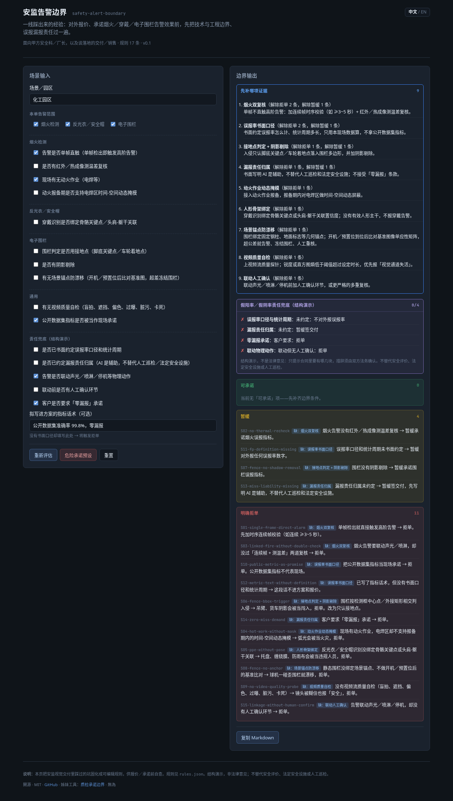

# 安监告警边界

一线踩出来的经验，不是又一个检测 Demo。

**[在线试用 → https://bianwuwei.github.io/safety-alert-boundary/](https://bianwuwei.github.io/safety-alert-boundary/)**

化工／重工园区的安监视觉（烟火检测、反光衣／安全帽、电子围栏），是天天被一线和安全科指着鼻子骂的重灾区。真正让项目暴雷、扯皮的，往往不是模型在公开数据集上的分数，而是**报价和承诺阶段没把技术与工程边界框死**：单帧就报警、没绑人形骨架就报穿戴违规、围栏按检测框判入侵、镜头糊了还报「安全」、球机碰歪了围栏跟着漂。

这个工具把这些边界固化成一份可编辑的规则清单：填入当前谈单的场景，立刻得到「可承诺 / 暂缓 / 明确拒单」三档结论、「先补哪项证据」排序，以及一块**假阳率／假阴率责任兜底**的结构清单。它不训练模型、不接摄像头——只帮你在方案和报价定稿前，把话收干净。

面向：**甲方安全科／厂长、正在谈落地的交付和销售团队**。

姊妹工具：[质检承诺边界 → https://bianwuwei.github.io/vision-promise-boundary/](https://bianwuwei.github.io/vision-promise-boundary/)

**English:** Safety Alert Boundary is a field-tested checklist for industrial safety-vision alarm projects in chemical and heavy-industry parks (fire/smoke detection, vest/helmet PPE checks, electronic fences). Before you quote or promise alarm performance, enter the deal scenario (single-frame triggering, thermal recheck, hot work and masking, body-skeleton binding, ground-point fence triggering, shadow removal, video quality probe, scene-anchor drift guard, written false-alarm definition, missed-alarm liability, physical linkage, zero-miss demands) and get an instant "OK to promise / Hold / Reject" verdict, the evidence to collect first, and a configurable false-alarm / missed-alarm liability checklist (a structure demo, not legal advice). The UI has a 中文 / EN toggle. **[Try it in English → https://bianwuwei.github.io/safety-alert-boundary/?lang=en](https://bianwuwei.github.io/safety-alert-boundary/?lang=en)**

---

## 我踩过的 5 个坑

### 1. 烟火检测把电焊弧光、晚霞反光当火灾

- **踩坑现场：** 模型在公开数据集上指标 99.8%，上到重工业厂房或露天装置区，傍晚夕阳打在不锈钢储罐的漫反射、夜间外包队伍突击赶工的电焊闪烁，直接触发火灾警报，甚至联动了防爆声光报警器和消防喷淋预警。
- **规则：** 单帧检测不得直接触发高阶告警；必须做时序连续帧校验（如连续 ≥3~5 秒）+ 红外／热成像测温差复核；电焊作业区在动火作业报备期内必须支持时间-空间动态掩模屏蔽。公开数据集指标不代表现场。

### 2. 反光背心／安全帽识别，被叉车上的警示色料包「一秒破防」

- **踩坑现场：** 叉车运送的一叠亮黄色托盘、高反光缠绕膜，或者堆放的红色防雨布，在广角畸变边缘被频繁误检为「违规人员滞留」，告警日志一天刷出 2000 多条，安全科直接拔了网线。
- **规则：** 人体属性识别必须绑定人体骨骼关键点或头肩-躯干关联置信度；未检测到有效的人形主干骨架，严禁抛出穿戴合规告警。

### 3. 电子围栏把吊车悬臂、货车阴影判作「人员闯入」

- **踩坑现场：** 在高压配电、吊装作业区划了虚拟电子围栏。吊车吊臂甩动拉出的阴影、大货车进厂时的投影扫过围栏，AI 直接把地面的动态阴影按入侵报警。
- **规则：** 入侵判定不得以检测框中心点或外接矩形相交为准；必须且仅以地面接地点（脚底关键点／车轮着地点）落入围栏多边形为有效触发，并增加阴影剔除。

### 4. 镜头被雨雾、蜘蛛网、高温蒸汽「物理致盲」，算法却判定现场安全

- **踩坑现场：** 管道蒸汽、梅雨季镜头水雾、夜间红外补光招来的蜘蛛网，把画面糊掉。算法看不到人也看不到火，就判「现场安全」——实际上现场已经彻底失去监控能力。
- **规则：** 引入视频流质量自检探针（盲拍、遮挡、偏色、过曝、镜头脏污、卡死）；画面锐度或直方图熵低于阈值超过设定时长，优先报「视觉通道失活告警」，严禁假死状态下的假安全。

### 5. 球机被碰歪、预置位没复位，标好的危险区域物理漂移

- **踩坑现场：** 交付时精心标好的红线，设备检修时维修工碰歪了球机，或巡检后预置位没精准复位，线就漂了：真有人进危险区不报警，人在安全通道走却疯狂滴滴。
- **规则：** 静态电子围栏必须绑定场景几何锚点（固定钢构支柱、地面标志物）；每次开机或预置位到位后自动比对基准图像的单应性矩阵，偏移超过公差立刻告警并冻结围栏，要求人工重新核验。

## 怎么用（交付／销售版）

1. 打开 [试用页](https://bianwuwei.github.io/safety-alert-boundary/)。
2. 先勾本单包含哪几类告警（烟火／穿戴／电子围栏），再逐项回答技术、工程和责任兜底问题。
3. 右侧即时得到「先补哪项证据」排序、责任兜底清单和三档结论；可点 **复制 Markdown** 贴进纪要或评审。
4. 需要演示「踩雷」时，点 **危险承诺预设**（典型的过度承诺话术：三类全上、单帧直触、公开数据集指标、联动喷淋无人确认、零漏报）。

本地预览：

```bash
cd docs
python3 -m http.server 8080
# 浏览器打开 http://127.0.0.1:8080/
```

站点放在 `docs/`，GitHub Pages → `main` / `/docs`。

点 **危险承诺预设** 后的完整页面：



## 规则可编辑

规则在 [`docs/rules.json`](docs/rules.json)，每条包含：

| 字段 | 含义 |
| --- | --- |
| `id` | 规则编号（`S01`…） |
| `when` | 条件（`all` / `any` + `eq` / `neq`） |
| `outcome` | `allow` \| `defer` \| `reject` |
| `message` | 中文说明 |
| `message_en` | 英文说明（切到 EN 时显示；缺省则回退中文） |
| `gaps` | 这条规则缺的证据（对应 `gaps` 表里的键），用来排序「先补哪项」 |

- 顶层 `gaps` 表给每项证据写了名字和下一步动作（`label` / `action`，英文 `label_en` / `action_en`）。排序：每条拒单 3 分、每条暂缓 1 分，按补齐一项证据能解除的总分从高到低排。
- 顶层 `liability` 是**假阳率／假阴率责任兜底**的配置：`items` 里每项有 `label`、`okWhen`（和规则同一套 `all`/`any` + `eq`/`neq` 条件）、满足时显示的 `ok` 和不满足时显示的 `missing`；`ruleIds` 标出哪些规则属于责任兜底。改这里就能增删兜底项。

改完保存，刷新页面即生效（无需构建）。引擎在 [`docs/assets/app.js`](docs/assets/app.js)。

## 已知局限（v0.1）

- 规则只来自上面 5 个坑和责任兜底，不覆盖其他告警类型（如抽烟、打电话、跌倒等）。
- 只判「有没有」，不判「做得好不好」：比如勾了「有热成像复核」，工具不检查温差阈值、连续帧时长是否合理。
- 分数是固定权重（拒单 3、暂缓 1），还不支持按项目调整权重或「部分满足」。
- 规则引擎目前只支持 `all`/`any` + `eq`/`neq`。
- 责任兜底只给结构，不给条款措辞。

## 关于作者

**無為（彼岸AI 创始人 / 公众号「無為聊AI」作者）**  
长期扎在一线做离散制造与工业视觉检测落地。深知算法在 Jupyter Notebook 里跑出的 99% 和工厂车间稳定运行的 99% 之间隔着整整一条护城河。不做空中楼阁的 AI 概念，只做能算得过来账、能顺利交付的工程系统。

- 个人主页：https://bianwuwei.github.io/portfolio/
- GitHub：https://github.com/bianwuwei
- 站点：http://www.bian-ai.cn/

## 免责声明

本工具是**结构演示**：帮助团队对齐「什么时候不该口头答应」。**不是法律意见**，不作合同、报价或合规审批的替代；**不替代安全评价、法定安全设施或人工巡检**。AI 告警只是辅助手段，真正的红线和责任划分仍须你们内部流程、安全管理部门与法务确认。

## License

[MIT](LICENSE) © 無為 (bianwuwei)
